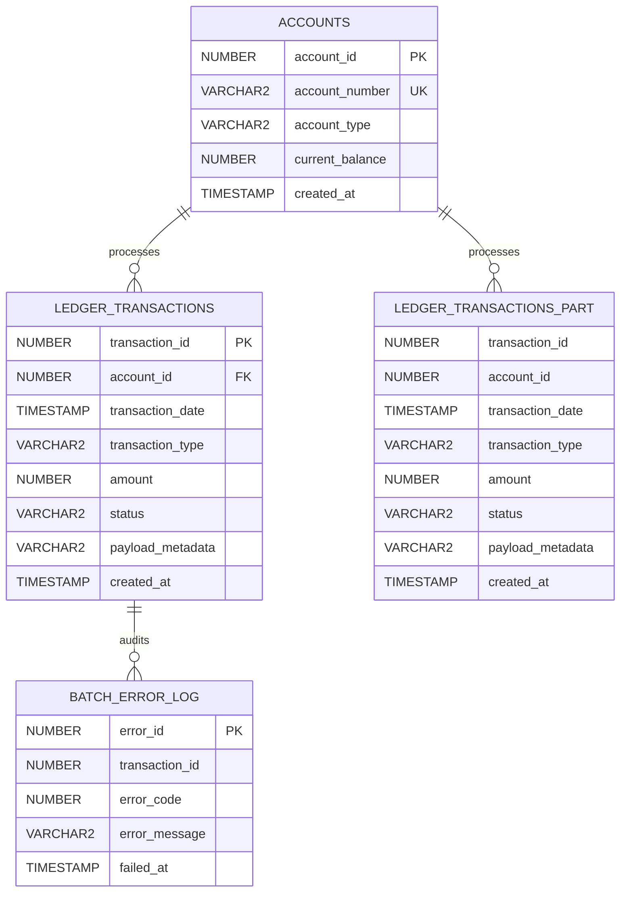

# ⚡ Database Performance Benchmarking & Refactoring Suite

[](#)
[](#)
[](#)
[](LICENSE)

Un laboratorio reproducible de ingeniería de bases de datos de alto rendimiento enfocado en diagnóstico de cuellos de botella reales, análisis de planes de ejecución (`DBMS_XPLAN`), optimización de CBO, procesamiento masivo por lotes y particionamiento físico sobre un **dataset transaccional de 10,000,000 de registros**.

---

## 🎯 Resumen Ejecutivo & Resultados Empíricos

Este repositorio documenta el impacto de tres técnicas clave de refactorización sobre un libro mayor transaccional (*financial ledger*), midiendo I/O lógico (`Consistent Gets`), I/O físico (`Physical Reads`) y tiempos de CPU.

### Resumen Comparativo de Benchmarks

| Caso de Estudio | Métrica Clave Evaluada | Baseline (No Optimizado) | Refactorizado | Impacto / Ganancia |
| :--- | :--- | :--- | :--- | :--- |
| **1. Sargabilidad & Covering Index** | Latencia de consulta transaccional | 13.60 s | **0.01 s** | **99.9% (1,360x más rápido)** |
| | I/O Lógico (Buffers en RAM) | 157,000 bloques | **67 bloques** | **99.95% menos estrés en memoria** |
| **2. PL/SQL Batch Processing** | Tiempo CPU en lote de 100k filas | 21.51 s | **9.00 s** | **58.1% (2.39x throughput)** |
| | Context Switching (PL/SQL $\leftrightarrow$ SQL) | ~100,000 llamadas | **20 llamadas** | **99.98% menos context switches** |
| **3. Partition Pruning** | Reporte analítico mensual (10M tabla) | 10.56 s | **1.12 s** | **89.4% (9.4x más rápido)** |
| | I/O de Bloques (Buffers / Reads) | 170,000 bloques | **14,812 bloques** | **91.3% menos I/O de segmento** |

---

## 🧱 Arquitectura y Modelo de Datos



### Ingeniería del Dataset Sintético (Sesgo y Realismo)

* **Principio de Pareto (80/20) en Cuentas:** Concentra el 80% del volumen transaccional en un 20% de cuentas activas mediante distribuciones exponenciales (`POWER(DBMS_RANDOM.VALUE(0, 1), 3)`), desafiando las estimaciones de cardinalidad del CBO.
* **Cardinalidad Asimétrica:** `COMPLETED` (90%), `PENDING` (7%), `FAILED` (2%), `FLAGGED_FRAUD` (1%).
* **Carga Masiva de Alto Rendimiento:** Generación de 10 millones de filas en menos de 60 segundos usando Direct-Path Insert (`INSERT /*+ APPEND */`) con tablas en modo `NOLOGGING`.

---

## 🔬 Casos de Estudio Desarrollados

### Caso 1: Violación de Sargabilidad vs. Índice Compuesto de Cobertura

* **Problema:** Predicado envuelto en función `TRUNC(transaction_date) = :fecha` forzando un `TABLE ACCESS FULL` sobre 10M de filas.
* **Solución:** Reescritura a rango semiabierto (`transaction_date >= :f1 AND transaction_date < :f2`) + índice de cobertura (`transaction_date, status, amount`).
* **Resultado:** Acceso directo vía `INDEX RANGE SCAN`, reduciendo el I/O lógico de 157,000 buffers a solo 67 buffers.

### Caso 2: Procesamiento Masivo por Lotes (Batch Processing)

* **Problema:** Conciliación de 100,000 filas mediante cursor procedural fila a fila (*row-by-row / slow-by-slow*), saturando la CPU por *context switching*.
* **Solución:** Extracción vectorizada con `BULK COLLECT LIMIT 5000`, ejecución masiva con `FORALL ... UPDATE` y captura resiliente de excepciones con `SAVE EXCEPTIONS` hacia tabla de auditoría `batch_error_log`.
* **Resultado:** Procesamiento 2.39x más veloz, con aislamiento de transacciones anómalas sin abortar el pipeline.

### Caso 3: Segmentación Física con Interval Partitioning & Pruning

* **Problema:** Consultas analíticas agregadas sobre meses específicos forzadas a escanear toda la tabla monolítica, compitiendo por memoria contra transacciones en vivo.
* **Solución:** Implementación de `INTERVAL (NUMTOYMINTERVAL(1, 'MONTH'))` con índices locales particionados.
* **Resultado:** Activación de `PARTITION RANGE SINGLE` (`Pstart=14`, `Pstop=14`), descartando el 96% de los datos físicos y reduciendo el tiempo de 10.56s a 1.12s.

---

## 🛠️ Reproducibilidad en Local (Docker & macOS)

```bash
# 1. Levantar contenedor Oracle Database 23ai Free
docker compose -f docker/docker-compose.yml up -d

# 2. Inicializar esquema y generar 10M de registros sintéticos
docker exec -i oracle-23ai-benchmark sqlplus -S / as sysdba < docker/init/01_schema_baseline.sql
docker exec -i oracle-23ai-benchmark sqlplus -S / as sysdba < docker/init/02_seed_generator.sql

# 3. Ejecutar los benchmarks
docker exec -i oracle-23ai-benchmark sqlplus -S 'BENCHMARK_USER/Benchmark2026!@localhost:1521/FREEPDB1' < src/baseline/01_slow_queries.sql
docker exec -i oracle-23ai-benchmark sqlplus -S 'BENCHMARK_USER/Benchmark2026!@localhost:1521/FREEPDB1' < src/optimized/01_fast_queries.sql

docker exec -i oracle-23ai-benchmark sqlplus -S 'BENCHMARK_USER/Benchmark2026!@localhost:1521/FREEPDB1' < src/baseline/00_setup_audit.sql
docker exec -i oracle-23ai-benchmark sqlplus -S 'BENCHMARK_USER/Benchmark2026!@localhost:1521/FREEPDB1' < src/baseline/02_slow_batch.plsql
docker exec -i oracle-23ai-benchmark sqlplus -S 'BENCHMARK_USER/Benchmark2026!@localhost:1521/FREEPDB1' < src/optimized/02_fast_batch.plsql

docker exec -i oracle-23ai-benchmark sqlplus -S 'BENCHMARK_USER/Benchmark2026!@localhost:1521/FREEPDB1' < src/baseline/03_slow_partition_query.sql
docker exec -i oracle-23ai-benchmark sqlplus -S 'BENCHMARK_USER/Benchmark2026!@localhost:1521/FREEPDB1' < src/optimized/03_setup_partitioning.sql
docker exec -i oracle-23ai-benchmark sqlplus -S 'BENCHMARK_USER/Benchmark2026!@localhost:1521/FREEPDB1' < src/optimized/03_fast_partition_query.sql
```

---

## 👤 Autor

**Juan Camilo Marín García**  
*SQL Data Engineer & Database Specialist*