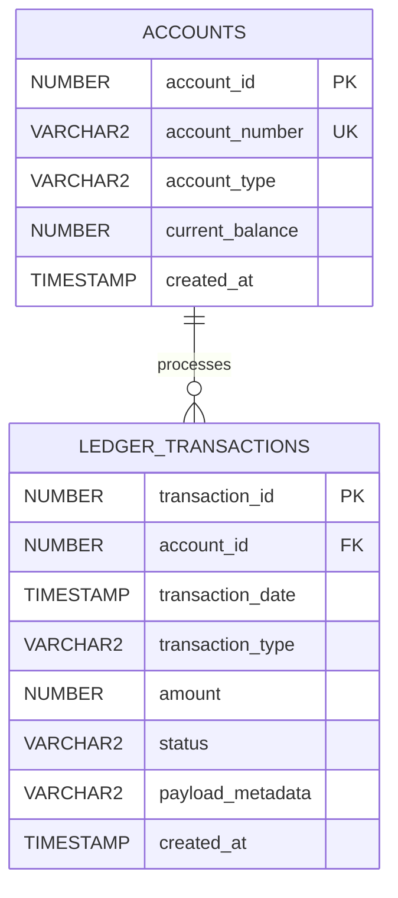

# ⚡ Database Performance Benchmarking & Refactoring Suite

[](#)
[](#)
[](#)
[](LICENSE)

A reproducible, containerized performance-tuning laboratory demonstrating advanced relational database tuning, Cost-Based Optimizer (CBO) analysis, execution plan diagnosis, and storage/index access refactoring over an empirically skewed **10,000,000-row financial ledger dataset**.

---

## 📌 Executive Summary

In high-throughput Online Transaction Processing (OLTP) and financial clearing platforms, improper indexing strategies, non-sargable query predicates, and inefficient data access patterns cause severe resource starvation. These bottlenecks manifest as massive **Buffer Cache thrashing**, unnecessary physical disk reads, CPU spikes, and locking contention under peak operational loads.

This project delivers a repeatable environment in **Oracle Database 23ai Free** to benchmark real-world database degradation and measure the return on investment (ROI) of targeted database-level refactoring.

### 📊 Empirical Benchmark Results (Case 1)

| Metric | Baseline (Unoptimized) | Refactored (Covering Index) | Net Impact |
| :--- | :--- | :--- | :--- |
| **Execution Plan Operation** | `TABLE ACCESS FULL` | `INDEX RANGE SCAN` | Direct B-Tree traversal |
| **Actual Elapsed Time (`A-Time`)** | **13.60 s** | **0.01 s** | **99.93% reduction (~1360x faster)** |
| **Logical I/O (`Buffers` / Gets)** | **157,000 blocks** | **67 blocks** | **99.95% reduction in memory reads** |
| **Physical I/O (`Reads`)** | **157,000 blocks** | **0 blocks** | **100% eliminated disk bottlenecks** |
| **Optimizer Cost (`Cost %CPU`)** | 43,749 (1%) | 69 (0%) | Reduced CPU cycle consumption |

---

## 🧱 Architecture & Domain Model

The schema models an enterprise financial transactional ledger running inside a Pluggable Database (`FREEPDB1`).



### 🎲 Realistic Synthetic Data Generation (Pareto & Skewness)

Benchmarking against uniform random data generates deceptive execution plans because cost-based optimizers rely on column cardinality and frequency histograms. To mirror production reality, the data generator (`docker/init/02_seed_generator.sql`) introduces deliberate distributions:

1. **Volume:** 100,000 accounts (`ACCOUNTS`) and 10,000,000 transactions (`LEDGER_TRANSACTIONS`).
2. **Account Activity (Pareto 80/20 Distribution):**
   Implemented via power transforms:
   $$\text{account\_id} = 1 + \lfloor N \cdot (U^3) \rfloor$$
   Concentrating over 80% of transactional volume within roughly 20% of accounts.
3. **Status Asymmetry (Cardinality Skew):**
   - `COMPLETED`: ~90%
   - `PENDING`: ~7%
   - `FAILED`: ~2%
   - `FLAGGED_FRAUD`: ~1%
4. **Engine-Level Pipeline Optimization:**
   Populated in 1,000,000-row batches using `INSERT /*+ APPEND */` (Direct-Path Insert) and table-level `NOLOGGING` to bypass buffer cache thrashing and excessive redo log generation, concluding with `DBMS_STATS.GATHER_TABLE_STATS`.

---

## 🔬 Benchmark Case Studies

### Case 1: Sargability Violation & Covering Index Strategy

#### The Problem
A daily settlement query aggregates transaction counts and amounts for a single calendar day filtering by `status = 'COMPLETED'`. 

The original production query wrapped the indexed column inside a SQL function:
```sql
WHERE TRUNC(transaction_date) = TO_DATE('2026-05-15', 'YYYY-MM-DD')
  AND status = 'COMPLETED'
```

#### Diagnostic & Cost-Based Optimizer Behavior
- **Sargability Breakdown:** Wrapping `transaction_date` in `TRUNC()` invalidates standard B-Tree index traversal. The optimizer cannot deduce start/stop keys on the tree and degrades to a full segment scan.
- **Buffer Pool Pressure:** The query scanned the entire 10M-row segment, requesting **157,000 memory blocks** (`consistent gets`) and causing direct disk reads to retrieve only 12,372 target rows.

```text
------------------------------------------------------------------------------------------------------------------
| Id  | Operation          | Name                | Starts | E-Rows | Cost (%CPU)| A-Rows |   A-Time   | Buffers |
------------------------------------------------------------------------------------------------------------------
|   0 | SELECT STATEMENT   |                     |      1 |        | 43749 (100)|      1 |00:00:13.60 |     157K|
|   1 |  HASH GROUP BY     |                     |      1 |  25006 | 43749   (1)|      1 |00:00:13.60 |     157K|
|*  2 |   TABLE ACCESS FULL| LEDGER_TRANSACTIONS |      1 |  25006 | 43749   (1)|  12372 |00:00:13.60 |     157K|
------------------------------------------------------------------------------------------------------------------
```

#### Refactoring & Technical Decisions
1. **Preserving Sargability (Range Condition):** Replaced the equality operator on the truncated date with an open-ended date range, enabling the engine to leverage index boundary scans:
   ```sql
   WHERE transaction_date >= TO_DATE('2026-05-15 00:00:00', 'YYYY-MM-DD HH24:MI:SS')
     AND transaction_date <  TO_DATE('2026-05-16 00:00:00', 'YYYY-MM-DD HH24:MI:SS')
     AND status = 'COMPLETED'
   ```
2. **Covering Composite Index:** Designed an index on `(transaction_date, status, amount)`. Including `amount` satisfies the aggregation `SUM(amount)` entirely within the index leaves, completely eliminating `TABLE ACCESS BY INDEX ROWID`.

```text
------------------------------------------------------------------------------------------------------------------
| Id  | Operation          | Name                  | Starts | E-Rows | Cost (%CPU)| A-Rows |   A-Time   | Buffers |
------------------------------------------------------------------------------------------------------------------
|   0 | SELECT STATEMENT   |                       |      1 |        |    69 (100)|      1 |00:00:00.01 |      67 |
|   1 |  SORT GROUP BY NOSORT|                     |      1 |   3421 |    69   (0)|      1 |00:00:00.01 |      67 |
|*  2 |   INDEX RANGE SCAN | IDX_LEDGER_PERF_COVER |      1 |   3421 |    69   (0)|  12372 |00:00:00.01 |      67 |
------------------------------------------------------------------------------------------------------------------
```

---

## 📁 Repository Structure

```text
.
├── docker/
│   ├── docker-compose.yml          # Container configuration for Oracle 23ai Free
│   └── init/
│       ├── 01_schema_baseline.sql  # PDB session, schema DDL & core constraints
│       └── 02_seed_generator.sql   # 10M-row high-performance synthetic data seeder
├── docs/
│   └── execution_plans/
│       ├── query_01_baseline.txt   # Raw DBMS_XPLAN execution telemetry (Baseline)
│       └── query_01_optimized.txt  # Raw DBMS_XPLAN execution telemetry (Optimized)
├── src/
│   ├── baseline/
│   │   └── 01_slow_queries.sql     # Anti-pattern reproduction script
│   ├── optimized/
│   │   └── 01_fast_queries.sql     # Sargable refactoring + composite index setup
│   └── telemetry/
│       └── capture_metrics.sql     # Session I/O & resource profiling queries
├── .gitignore                      # Git exclusion rules (isolating local agent/spec tooling)
└── README.md                       # Engineering case study and reproducibility guide
```

---

## 🚀 Quickstart & Reproducibility

### Prerequisites
- Docker Desktop (configured with at least 4 GB RAM and 2 GB Swap).
- macOS / Linux terminal with Git and `sqlplus` (or VS Code Oracle Extension).

### 1. Clone & Branch Setup
```bash
git clone https://github.com/<your-username>/db-performance-benchmark.git
cd db-performance-benchmark
git checkout develop
```

### 2. Start Oracle 23ai Free Engine
```bash
docker compose -f docker/docker-compose.yml up -d
```
*Wait until the health check logs display `DATABASE IS READY TO USE!`.*

### 3. Provision Schema and Seed 10M Records
```bash
# Initialize schema, permissions, and tables
docker exec -i oracle-23ai-benchmark sqlplus -S / as sysdba < docker/init/01_schema_baseline.sql

# Execute parallel batch insertion (takes ~30-90 seconds)
docker exec -i oracle-23ai-benchmark sqlplus -S / as sysdba < docker/init/02_seed_generator.sql
```

### 4. Run Benchmark Case 1
```bash
# Execute baseline test
docker exec -i oracle-23ai-benchmark sqlplus -S 'BENCHMARK_USER/Benchmark2026!@localhost:1521/FREEPDB1' \
  < src/baseline/01_slow_queries.sql | tee docs/execution_plans/query_01_baseline.txt

# Execute optimized test
docker exec -i oracle-23ai-benchmark sqlplus -S 'BENCHMARK_USER/Benchmark2026!@localhost:1521/FREEPDB1' \
  < src/optimized/01_fast_queries.sql | tee docs/execution_plans/query_01_optimized.txt
```

---

## 🛠️ Engineering Standards & Workflow

- **Branching Model:** Strictly governed using **Git Flow** (`main` for tagged releases, `develop` for baseline integration, and dedicated `feature/*` branches for individual benchmark cases).
- **Environment Isolation:** Local spec orchestration (`specs/`, `.agents/`, `skills/`) is fully isolated from the remote git tree via `.gitignore` to keep the public repository focused purely on production code, SQL engineering, and execution statistics.

---

## 👤 Author

**Juan Camilo Marín García**  
*SQL Data Engineer & Database Specialist*  
[LinkedIn](https://linkedin.com) • [GitHub](https://github.com)